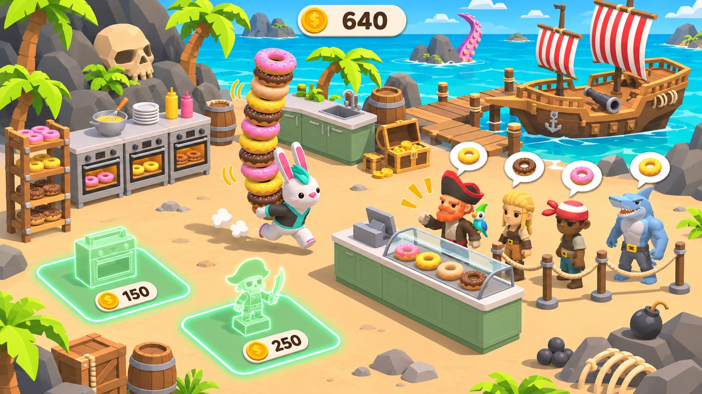
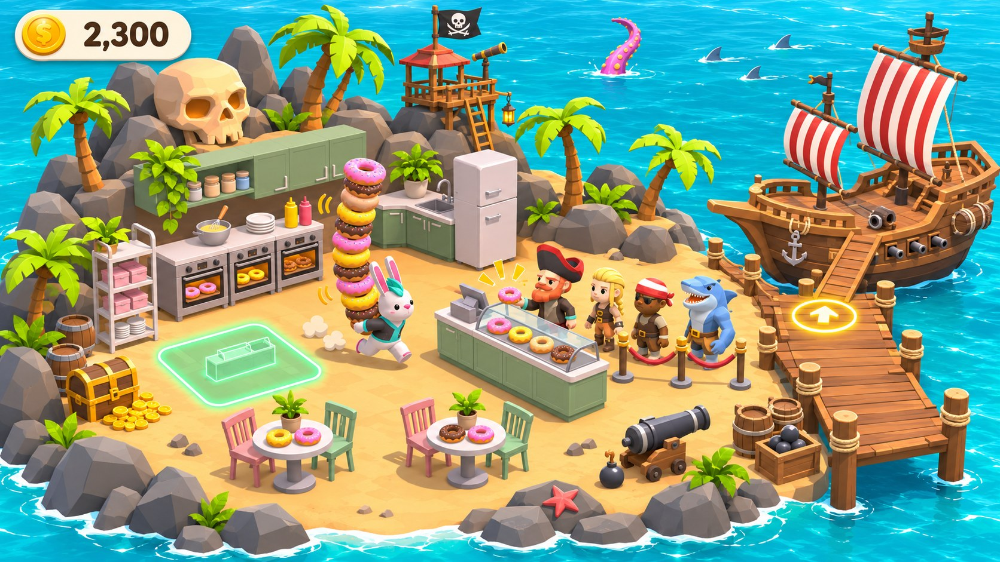
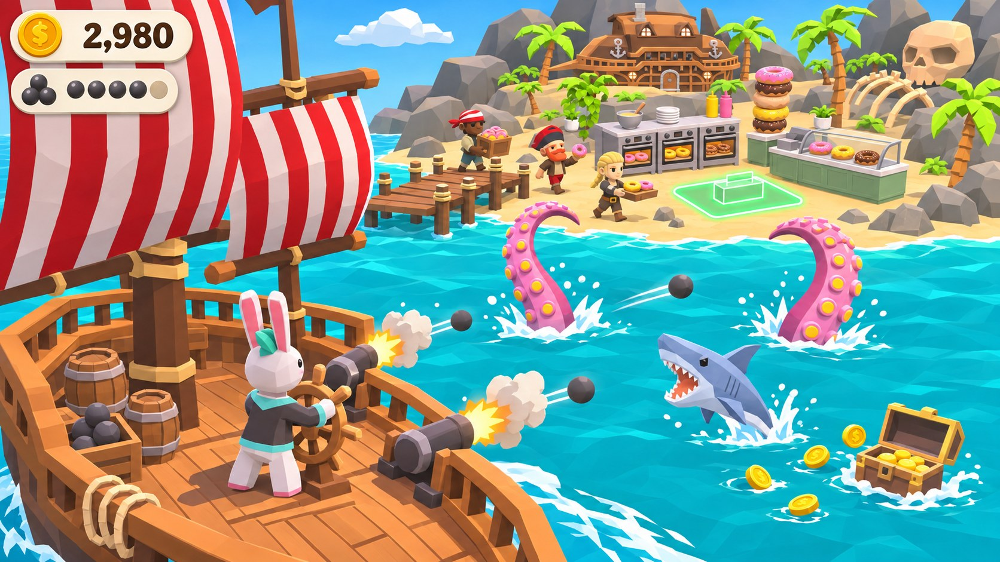

# Donut Cove

Run a donut shop on a tiny pirate island and grow it into a huge kitchen. You are a bunny baker: ovens bake donuts onto racks, you scoop them into a wobbling tower on your back and run them to the counter, where a queue of pirates (a captain with a parrot, a blonde swordswoman, a bandana deckhand, a shark man) pays in gold coins that land on the counter. Spend the coins by standing on glowing pads: new ovens, a glass display case, tables, a pirate statue, a helper bunny, and finally your own ship. Then set sail around the island, blast kraken tentacles and sharks with your cannons, scoop the floating loot, and bring it back to the dock to finish the shop with the Captain's Donut House.

| Item | Value |
| :-- | :-- |
| Video | Xogot video 9, long form, 16:9: "Xogot AI for Godot (xo)". The product shown is **xo**: a coding agent in the Claude desktop app drives a stock Godot editor through the xo CLI and the godot-xo skill, as an alternative to an MCP. |
| Builder | Claude Fable 5.2 in the Claude Code desktop app on Windows, one autonomous run |
| Engine | Godot 4.7.2 stable (stock editor at `D:\Godot 4.7.2\`), Forward Plus, Jolt Physics, D3D12, TAA, Windows desktop |
| Editor bridge | **xo 0.1.0 only** (Xogot's `xo` CLI plus the `addons/xo` GDExtension plus the `godot-xo` skill). No Godot AI, no MCP of any kind (Section 0). |
| Input | Keyboard and mouse |
| Art | Free CC0 Quaternius packs already in `assets/quaternius/` (Section 11). Water, sky, glass, glow, coins, pads, particles and UI are Godot native. |
| Session | About 5 minutes from the first donut to the finale, then free play |

## Quick gameplay: read this first (mandatory, details in `skills/game-dev/references/quick-gameplay/quick-gameplay.md`)

**Few mechanics. Few short stages. Everything polished.**
The video shows about 60 to 90 seconds of gameplay, so quality of content beats quantity of content. A short, focused game is the goal, not a compromise.
When time runs short, cut content, never polish.

1. **Signature mechanic:** the donut tower on your back. Ovens bake donuts onto racks, the bunny scoops them into a stack that trails and sways as she runs, and the stack empties into the counter faster and faster while pirates pay in coins that fly to the HUD. It must be on screen within 10 s of pressing Play: the first oven is already baking and two pirates are already in the queue.
2. **Supporting mechanics (two):** (a) unlock pads that drain coins while you stand on them and pop the purchase into the world; (b) sailing the bought ship around the island and firing cannons at kraken tentacles and sharks for floating loot.
3. **Stages (4), each short and visually distinct:**

   | # | Setting / look | What it shows on camera | Target time |
   | :-- | :-- | :-- | :-- |
   | 1 | The beach stall (Concept 1): one oven, the counter, a queue, sunny sand | The back stack, the first sale, the first pad (second oven) under 15 s | 45 to 60 s |
   | 2 | The kitchen grows (Concept 2): three ovens, glass display case, tables with seated pirates, statue, helper bunny | Accelerating feed cadence, three flavors, a worker using the same stations, pads popping in | 60 to 90 s |
   | 3 | Set sail (Concept 3): the ship pad on the dock, then open turquoise sea around the island | Buying the ship, boarding, sailing, cannon broadsides, sharks and tentacles, floating loot | 60 to 90 s |
   | 4 | The Kraken (finale): the cove darkens, three giant tentacles rise around the ship, then the Captain's Donut House pops in on the cliff | A boss beat, a treasure burst, the final purchase with a camera beat, the end card | 45 to 60 s |

4. **Not built:** a shop menu, a crafting tree, raw ingredients, a second island, day and night, quests, dialogue, character customization, multiplayer, gamepad, mobile controls, offline earnings, prestige, save of the shop progress (each session starts at the beach stall: that is the show).
5. **Cut order if time runs short:** the second worker, then the tables, then the shark variety (keep one shark type), then the cannon upgrade pad. Never cut the back stack feel, the coin flight, the pad reveals, the ship, the tentacles or the finale.
6. **Build order rule:** a stage is not started until the previous stages pass the perceptual gate (juice, render, themed UI, zero placeholders).

**Acceptance.**

* From Play (after the title screen), the bunny is carrying donuts in under 10 s.
* A competent player reaches the end card in 4 to 6 minutes without the debug panel.
* Every stage is distinct in a thumbnail size frame and has its line in the table above.
* No more than 4 stages and 3 mechanics exist without Marco's explicit OK.

## Build directive: read first

1. This document is the build contract. Where it states a number, use it. Where it leaves a detail open, choose the simplest option that keeps the game fun and readable, write the decision in `docs/records/BUILD_NOTES.md`, and move on.
2. The video is recorded from this build. The game must look finished from the first frame of play: no default Godot UI, no default font, no placeholders, no debug overlays left on, no grey boxes.
3. **Godot is driven ONLY through xo** (Section 0). Never install, enable, connect or call Godot AI, Fennara, or any other Godot MCP, even if tools with those names appear in your session.
4. **The back stack is the game.** It must feel juicy and satisfying at every pickup and every sale (Sections 3 and 13). If you must cut scope, cut anything else first (cut order above).
5. Every game element has its own saved scene with named, selectable nodes (Rule 1c of `skills/game-dev/SKILL.md`), authored through xo. The whole world exists in the saved scenes before Play.
6. Keep it cozy and cartoon: no blood, no gore. Sharks and tentacles burst into splashes, bubbles and coins; a wrecked ship limps back to the dock.
7. **Build the whole game end to end without stopping.** The only valid stop is a genuine external blocker after the recovery steps in `AGENTS.md`: xo cannot reach this project's editor. Everything else (including a failed performance check, Section 15) you fix and continue.

## 0. The tooling: xo only

### 0.1 Why this section exists

This video exists to show Xogot's xo: an agent in the Claude desktop app building a full game in a stock Godot editor through a command line tool and a skill, instead of an MCP. Marco's rule for this project: **no Godot AI and no MCP, only Xogot's tools.** The Hub template for recorded builds (Skill 30) normally installs the Godot AI MCP; that step is deliberately skipped here because the sponsor's product is the bridge. A second bridge on screen is a problem with the sponsor.

### 0.2 What is installed

| Piece | Where |
| :-- | :-- |
| **`tools/xo` (use this, always)** | A Git Bash wrapper around `xo.exe`, measured and written on 2026-11-11 because on this Windows machine the xo CLI cannot connect to the editor's unix socket. It starts the editor with a TCP listener and sends every command over `127.0.0.1:47321` with a token kept outside the repo. **Read `docs/context/xo-windows.md` first.** `bash tools/xo up` starts or reuses the editor; `bash tools/xo <any xo arguments>` runs a command; `bash tools/xo down` quits the editor. Never call `xo.exe` directly and never use `xo launch`. Everywhere this GDD writes `xo <command>`, run `bash tools/xo <command>`. |
| `xo` executable | `C:/Users/Usuario/Downloads/xo-0.1.0-windows-x86_64/xo-0.1.0-windows-x86_64/bin/xo.exe` (xo 0.1.0, the build Xogot sent), called only through `tools/xo`. |
| xo addon | `res://addons/xo/` (GDExtension, installed for this project). **Never edit, move, reinstall or commit it.** |
| godot-xo skill | Installed by xo for Claude Code in `.claude/skills/godot-xo/`. Read its `SKILL.md` and the `references/` its routing table names for each task (`xo-editor-and-scenes`, `xo-nodes-and-scripts`, `xo-project-files`, `xo-run-debug-test`, `xo-content-builders`, `xo-batch-and-eval`). |
| Godot | `D:\Godot 4.7.2\Godot_v4.7.2-stable_win64.exe`, started by `bash tools/xo up` (an editor opened by double click cannot be reached by xo) |
| Measured xo gotchas | `skills/game-dev/references/xogot-xo/xogot-xo.md` (211 xo calls of an earlier Xogot build, 49 with errors, with the fixes). Read it before the first edit and recheck each item against the installed skill: some may be fixed in 0.1.0. |

### 0.3 The rules of driving Godot

1. **Inspect, act, verify, save** (the session loop of the godot-xo skill): `xo editor state` first, then `xo scene tree` / `xo node find` for exact paths, then the structured command, then `xo editor state` and `xo editor output` for new errors, then `xo scene save`.
2. Scenes, nodes, properties, signals, scripts, resources, materials, particles, cameras, audio, animations, UI, themes, project settings, autoloads and the InputMap all change through their xo commands. Scripts are written with `xo script create` and changed with `xo script patch`, and their returned diagnostics must be clean. Use `xo batch` for big scene assembly (it validates and rolls back). Use `xo eval` only where no structured command exists (the list is in the xogot-xo reference: measuring imported sizes, editable instances, nested sub resources such as an `Environment` with a `ProceduralSkyMaterial`, the audio bus layout, navigation bakes).
3. **Never write `.tscn`, `.tres`, `.res`, `.gd`, `.gdshader` or `project.godot` with a file tool, a shell redirect or Python.** The editor holds unsaved state; xo is the only writer. Plain Markdown records in `docs/records/` are the exception (they are not Godot files).
4. **Folders before saves.** A scene saved into a folder that does not exist is silently lost or lands in `res://`. Create the folder, `xo file scan --wait`, save, then confirm with `xo file search --ext tscn`.
5. **After editing a script with `@export` properties**, reload every open scene that instances it (`xo scene reload --force` only when it has no unsaved work you need) before the next save, and read the scene diff.
6. **Negative numbers:** write `--position=-2,0,9`, never `--position -2,0,9`.
7. `xo project run` saves first. `project run` and the `game` commands over the TCP wrapper were not verified when the wrapper was written: check them on the first run and log the result in `docs/context/xo-windows.md` style notes in `docs/records/XO_FEEDBACK.md`. If a second instance appears, resolve the target from `xo list` on every call, never from memory. Poll `xo game status` until live before `xo game eval`. A runtime error pauses the game at a breakpoint: read `xo debug errors`, then `xo debug resume`.
8. Behaviour tests run through `xo game eval --file` with complete scripts in `tests/game/` (that folder carries a `.gdignore`); structural tests through `xo test run --root res://tests/editor`.
9. Screenshots: clear the selection (`xo editor selection set --paths-json '[]'`), then `xo editor screenshot --source game` for the running game and `--source viewport` for the editor view, open every image and look at it before reporting a visual result. Short effects use the pause handshake of the xogot-xo reference.
10. At the end of every step: `git status`, and look for files you did not intend (a stray scene copy at `res://` is a known xo symptom).

### 0.4 xo feedback for Xogot (a deliverable)

Joseph at Xogot asked for feedback on xo. Keep `docs/records/XO_FEEDBACK.md` as you go: every xo command that failed (command, error, cause, workaround), every place you had to fall back to `xo eval`, missing structured commands you wished for, and what worked well (with counts). One line per item. It ships with the build report.

## 1. Concept match protocol (mandatory, the first and the last acceptance test)

**The one to one rule.** The three concept images in `concept/` are not mood boards: the sand, the water, the light and the layouts they show are reproduced one to one. Where a concept shows a layout (the kitchen line against the rocks, the counter with the queue rope, the dock and the ship, the tables), the build copies it element by element and with the same count: three ovens, one display counter with a register, four pirates in the queue, two round tables with two chairs each, one skull rock, one dock with the ship moored to its right. The light of each concept (high warm sun from the upper left, short soft shadows to the lower right, glowing green pads, sparkling turquoise water) is reproduced in Godot and judged in the comparison shots like everything else.

### 1.1 Measured values (read off the concept files on 2026-11-11, 1672 by 941 px each)

| Value | Concept 1 (beach stall) | Concept 2 (island) | Concept 3 (sea) |
| :-- | :-- | :-- | :-- |
| Camera | High three quarter view, about 45 to 50 degrees down, close on the stall | Higher and farther: the whole island as a diorama, horizon above the frame | Behind and above the bunny at the helm, island in the background |
| Horizon | About 9 percent from the top | Above the top edge | About 5 percent from the top, behind the island |
| Subject size | The bunny with her tower is about 25 percent of the frame height | The bunny is about 15 percent of the frame height | The bunny at the wheel is about 30 percent of the frame height, lower left |
| Mean luminance | 164 of 255, 2.9 percent of pixels below 64 | 148, 3.9 percent below 64 | 146, 3.3 percent below 64 |

Colours sampled from flat areas: sky #A9DDF9; shallow water #3ED3D5 to #69D9E5; deep water #07B9E1; sand #EDDA8F to #FCCC74; rocks warm grey; pads glowing mint green over the sand. Treat these as targets for the Section 10 light values; the game is a bright, saturated, sunny diorama, never grey, never dark.

### 1.2 Protocol

1. **Three concept cameras live in the saved scenes as named nodes:** `ConceptCam_Stall` (Concept 1), `ConceptCam_Island` (Concept 2) and `ConceptCam_Sea` (Concept 3, a pose the sea camera adopts when the ship sails past the dock heading west). In a development build `Tab` cycles the three (removed from the final build).
2. **The stall and the island are authored by hand to reproduce the concept compositions:** from left to right in Concept 1, the donut shelf, the three ovens with a mixing bowl, plates and bottles on top, the sink counter, barrels, the treasure chest with coins, the dock and the ship; in front, the two pads (oven 150, statue 250), the counter with the glass case and the register, the four pirates behind the rope, the bomb and cannonballs, the rocks and bones.
3. **After every visual milestone** take a screenshot at 1920 by 1080 from each concept camera that already applies, compose concept left and screenshot right at the same height, and save `docs/records/evidence/comparison-01.png`, `comparison-02.png`, and so on. Never overwrite.
4. **Check in this order, fix the biggest mismatch first:** camera height and horizon, distance and field of view, subject position, main silhouettes (rocks, ovens, counter, ship), props, palms and background islands, sky gradient, water colour and foam, sand colour, sun direction and shadow softness, glow, grade, HUD size and placement. Expect five to ten rounds per concept.
5. **Light is matched by value** (Section 10) and the final values go in `docs/records/BUILD_NOTES.md`.
6. The final comparison is `docs/records/evidence/comparison-final.png` (the three pairs stacked). It is item 1 of the definition of done.

**Acceptance:** `comparison-final.png` exists and every pair reads as the same game; the three concept camera nodes are in the saved scenes; the stall and island layouts carry the same counts as the concepts.

## 2. Product direction

### 2.1 Player fantasy

Cozy hustle: the satisfaction of a tower of donuts swaying on your back, a queue of grumpy pirates turning happy, coins raining onto the counter, a shop that grows around you in pops and sparkles, and then the freedom of your own ship and a cannon broadside that sends a kraken tentacle back under the waves.

### 2.2 The first minute (the video depends on it)

1. The title screen is the live island seen through a slow camera tour (Section 9). Press Start: a 0.4 s fade to the stall camera.
2. Oven 1 (strawberry) already has 4 donuts on its rack. Two pirates already wait in the queue with bubbles. The bunny starts with 60 coins. A bouncing arrow points at the oven.
3. Within 5 s the player scoops donuts (the tower grows with a pitched pickup ladder); within 10 s the first pirate is served and coins fly to the HUD; within 15 s the player stands on the first pad (Oven 2, 40 coins) and a chocolate oven pops in with dust and confetti.
4. By minute 3 the kitchen has three ovens, the display case, a table, the statue and the helper bunny. By minute 4 the ship is bought.

### 2.3 Session shape

Stage 1 to 4 as in the quick gameplay table, about 5 minutes. After the end card the player keeps playing freely (sailing for loot, selling donuts). Nothing is lost: the end card is a celebration, not a game over.

## 3. Tycoon feel (mandatory, read `skills/game-dev/references/tycoon-juice/tycoon-juice.md` before building)

**Principle.** No value changes without a visible carrier, and no carrier arrives without feedback. Every donut and every coin is a physical object that travels on an arc, lands with a squash, makes the thing it joined react, plays a pitched sound and shows a number. Nothing is added to a counter silently and no progression happens in a menu.

1. **Back stack.** The bunny carries donuts in a tower on her back (`CarryStack`, capacity 6 to start, 10 after the backpack pad, 16 after the second backpack upgrade). Each donut follows its slot with its own stiffness (stiff at the bottom, loose at the top), so the tower trails the runner, leans into turns and sways. Donuts lie flat with a random yaw offset, alternating flavors as they come. Pickup is an arc flight with a landing squash, a ripple up the tower and a pitch laddered sound. A full stack shows "MAX" over the head and a reject cue. The bunny blends into the `Run_Holding` / `Idle_Holding` / `Walk_Holding` clips while the stack is not empty (0.75 s blend, Section 7).
2. **Ovens are producers.** Each oven bakes one flavor onto its own rack (an `ItemTray` beside it, capacity 8), one donut every 1.6 s at level 1, with the oven door glowing and a little puff on each donut. Standing in the oven's pickup zone scoops the rack onto the stack on the accelerating cadence (0.16 s, times 0.88 per item, floor 0.05 s). A full rack visibly blocks the oven (a red outline and a "FULL" pop) until it is emptied.
3. **Customers and cash.** Pirates queue behind a rope at the counter (4 queue slots, then 6 after the display case). Each shows an order bubble with the flavor icon and the count (1 to 3). Standing in the counter zone flies the requested flavor from anywhere in the tower to the customer (the donuts above settle into the gap), on the accelerating feed cadence (0.22 s, times 0.85, floor 0.06 s). At zero the pirate is happy (a `Yes` or `Wave` clip, a heart and coin burst) and **physical coins land on the cash tray** on the counter. Walking over the tray flies the coins to the HUD counter, which rises as each coin lands with a chime that climbs per coin. Floating "+N" numbers appear where money was made. A pirate who waits too long leaves with a `No` shake and a sad puff; no other punishment.
4. **Progression by standing.** Every expansion is an unlock pad (Section 4.3). Standing on one drains coins at an accelerating rate (30 per second rising to 8 times over 1.4 s), the price counts down, coins fly from the bunny to the pad, and on completion the purchase pops into the world with a back ease, a dust ring, confetti and a camera focus beat if it is off screen. Each pad shows a translucent mint hologram of what it buys (the concept's ghost oven and ghost statue). A bouncing arrow always points at the next objective.
5. **Workers reuse the player's objects.** The helper bunny owns a `CarryStack`, scoops from the same oven racks and feeds the same counter by the same zones, with the same feedback.
6. **Pacing.** First purchase within 15 s. For the first 3 minutes, a meaningful purchase every 15 to 25 s. The helper appears before minute 3. The F1 debug panel shows every normal feedback (Section 13).
7. **Money is large and rolling.** The coin counter is the biggest HUD element (at least 64 px), never jumps, punches on gain, shakes on a rejected purchase. Pad prices at least 56 px equivalent. Buttons at least 88 px.
8. **Camera.** Fixed angle perspective camera, focus beats after unlocks, small trauma on purchases (Section 8).

**Modularity (Rule 1c).** Player, each donut flavor, each oven, rack, counter, cash tray, customer, worker, table, unlock pad, pop number, HUD, camera rigs, objective arrow, ship, cannon, cannonball, shark, tentacle, loot pickups and every effect are their own saved scenes authored through xo. Pools instantiate those scenes. Unlock targets are placed hidden in the level and revealed, never built by code.

**Acceptance (perceptual gate, judged on a frame contact sheet of one full loop):** every transfer has a visible arc, squash and sound; the stack trails at speed (top moves more than bottom) and recovers when stopped; pickup pitch climbs across a chain and resets; MAX and reject cues exist; the counter rolls as coins land; a pad drains while standing and reveals its purchase with a camera beat; the objective arrow is always present; first purchase under 15 s. Save the contact sheet in `docs/records/evidence/` and the tuned values in `docs/records/BUILD_NOTES.md` (and they are written back to the tycoon-juice reference by Marco's Hub later: you only log them).

## 4. The island

### 4.1 Layout (meters, north is minus Z, the dock is east)

The island is a sand plateau about 36 m east to west and 26 m north to south, ringed by rocks and cliffs, in a turquoise sea. The sand is a native mesh (a gently domed, rounded shape with a sand material and a darker wet rim at the waterline), never one painted image.

| Area | Where | What |
| :-- | :-- | :-- |
| Kitchen line | North edge, against the rocks and the skull cliff | Donut shelf, three oven slots (oven 1 built, ovens 2 and 3 as pads), mixing bowl, plates and sauce bottles on top, sink counter, fridge, wall cabinet |
| Counter | Centre, facing south east | The display counter with the register and the cash tray, the queue rope with stanchions running east |
| Queue and entrance | East of the counter, toward the dock | Pirates walk in from the dock end of the beach and line up |
| Tables | South west | Two round tables with two chairs each (pad), pirates sit and eat (`Sitting_Eating`) and leave coins on the table |
| Pads area | South of the kitchen line | The glowing pads of Section 4.3, placed where the concept shows them |
| Dock | East shore | A wooden dock 14 m long built from `Environment_Dock` pieces and `Environment_Dock_Pole` posts; the ship pad at its end; barrels, cannonballs, a cannon and a crate beside it |
| Decor | Around the rim | Palms, rocks, the giant skull on the cliff, whale bones on the sand, a treasure chest with gold, starfish, bombs |
| Cliff top | North west | The empty plot of the final purchase (the Captain's Donut House) |

### 4.2 Flavors and prices

| Flavor | Model | Oven | Sale price |
| :-- | :-- | :-- | --: |
| Strawberry sprinkles (pink) | `food/Donut1.obj` | Oven 1 (built at start) | 6 |
| Chocolate drizzle | `food/Donut4.obj` | Oven 2 (pad) | 8 |
| Honey glaze (yellow) | `food/Donut2.obj` | Oven 3 (pad) | 10 |

`Donut3` (plain) is the icon on the title logo and the end card only. Customers only order flavors whose oven exists; once three ovens exist about a third of orders mix two flavors.

### 4.3 Unlock pads (order, prices and what pops in)

The objective arrow walks through them in this order. Prices are starting values: tune so the pacing of Section 3.6 holds, and log the final numbers.

| # | Pad | Price | Reveals and effect |
| :-- | :-- | --: | :-- |
| 1 | Oven 2 | 40 | Chocolate oven pops into its slot |
| 2 | Glass display case | 80 | The counter gets its glass case filled with sample donuts, queue grows from 4 to 6 slots, customers arrive 25 percent faster |
| 3 | Bigger backpack | 100 | Capacity 6 to 10, the backpack gets a new tint |
| 4 | Oven 3 | 150 | Honey oven pops in (the concept's 150 pad) |
| 5 | Pirate statue | 250 | A skeleton pirate statue on a plinth (the concept's 250 pad): tips plus 20 percent, a rare customer becomes possible |
| 6 | Tables | 200 | Two round tables and four chairs; seated pirates order 2 to 3 donuts, eat, and leave a coin pile on the table |
| 7 | Helper bunny | 300 | A pink bunny worker runs ovens to counter on her own |
| 8 | Oven speed | 250 | All ovens bake 40 percent faster, a puff of flour on each oven |
| 9 | The ship | 600 | The large ship sails in and moors at the dock with a camera beat; a boarding pad appears at the dock end |
| 10 | Bigger backpack 2 | 350 | Capacity 10 to 16 |
| 11 | Double cannons | 400 | Appears at the dock after the first voyage: two cannons per side, faster reload |
| 12 | Captain's Donut House | 2,000 | The finale purchase on the cliff top (Section 6.6) |

**Rare customer:** Captain Barbarossa with his parrot pays 3 times the price, arrives about once a minute after pad 5, and gets a camera focus beat and a gold "+N".

### 4.4 Economy targets

Start cash 60. Customer arrival every 4 s at the start, every 3 s after pad 2. Expected income: about 1.5 coins per second at the start, 6 per second with three ovens and the helper, plus sea loot of 150 to 300 per voyage and about 900 for the Kraken. The finale is reachable in 4 to 6 minutes by a competent player. Log the measured times of each purchase in `docs/records/BUILD_NOTES.md`.

## 5. The ship and the sea

### 5.1 Boarding

Standing on the boarding pad at the dock end for 0.5 s fades the shore camera into the sea camera (0.45 s) as the bunny hops onto the deck by the wheel. Pressing `E` near the dock (or sailing back into the dock zone) docks the ship and returns to the island camera. The back stack stays on the island: donuts never go to sea.

### 5.2 Sailing

* `W` accelerates (top speed 9 m/s, 1.2 s to full), `S` slows and reverses slowly (2 m/s), `A` and `D` turn (55 degrees per second at speed, less when slow). The ship banks into turns (up to 6 degrees of roll) and bobs on the waves.
* A wake of foam trails the hull and spray bursts at the bow at speed (native particles).
* The sea is bounded by a soft ring at 140 m from the island centre: a current gently turns the ship back, with a light fog wall beyond. Two small rocky islets (cliff and palm models) sit in the sea for landmarks.
* The ship is the `Ship_Large` model. Hull health 100. Damage tints the deck flash red, shakes the camera and splashes water. At 0 the ship does not sink: it "limps home" in a cartoon fade to the dock with half its carried loot kept.

### 5.3 Cannons

* Aim with the mouse on the water plane; a dashed arc and a ring on the water show where the ball lands. Left click (or hold) fires the cannon on the side that faces the aim point (a 120 degree arc per side). Out of arc: a reject puff and click.
* Ammo: 5 cannonballs in the HUD (the concept's ball row), reloading one every 0.8 s; double cannons fire two balls per click and reload every 0.5 s.
* Every shot: muzzle flash, a smoke puff, recoil of the cannon model, camera trauma 0.15, a deep boom with random pitch. Every hit: a splash or impact burst, a hit flash on the target, a damage number.

### 5.4 Enemies

| Enemy | Model | Behaviour | Health | Loot |
| :-- | :-- | :-- | --: | :-- |
| Shark | `pirate/Characters_Shark.gltf` (`Swim`, `Swim_Fast`, `Swim_Bite`) | Circles the ship with its fin showing, then charges and leaps at the hull (a red ring telegraphs 1 s before), 10 damage | 2 hits | 15 to 25 coins floating where it vanished |
| Tentacle | `pirate/Characters_Tentacle.gltf` (`Tentacle_Idle`, `Tentacle_Attack`, `Tentacle_Attack2`, `Tentacle_Poke`) | Rises from a bubbling patch near the ship's path, sways, then slams across the deck after a 1.2 s telegraph (a shadow on the water, a rising rumble), 15 damage | 3 hits | A floating treasure chest worth 60 to 100 |

From the very first voyage both enemy types appear (the WOW is in the first minute): about 3 sharks and 2 tentacles active around the island at any moment, respawning out of view. Defeated enemies sink with a splash, bubbles and a coin burst.

### 5.5 Loot

Coins and chests float and bob with a glint. Sailing within 4 m pulls them to the ship on an arc with the coin chime ladder; they collect in the ship's hold (a small chest icon on the HUD with a count). On docking, the hold empties: coins fly from the ship along the dock to the HUD counter, rolling it up. Loot is never added silently.

### 5.6 The Kraken finale

After the first voyage that collects at least 150 coins (or from the debug panel), the next departure triggers the Kraken: the sky darkens to a stormy teal grade for 0.8 s, the music shifts, and three giant tentacles (the same model, larger and with a darker tint) rise in a ring around the ship in the cove south of the island. Each takes 6 hits and attacks in turn; when the last one falls, a giant golden chest bursts up from the sea with a fountain of coins (about 900), slow motion 0.5 for 0.4 s, confetti and a fanfare. The sky clears. The arrow points home.

### 5.7 The Captain's Donut House (the end)

The last pad (2,000) on the cliff top pops in `Environment_House1` (the ship shaped house) as the Captain's Donut House with a long camera beat, a pirate flag raised, fireworks of sprinkles, and every pirate on the island cheering. Then the end card: "Donut Cove is the best donut shop on the seven seas", total coins earned, donuts sold, sharks and tentacles defeated, time. "Keep playing" returns to the island.

## 6. Characters and animation

| Role | Model | Clips used |
| :-- | :-- | :-- |
| The baker (player) | `restaurant/Rabbit_Cyan.gltf` | `Idle`, `Run`, `Walk`, `Idle_Holding`, `Run_Holding`, `Walk_Holding`, `Yes` (purchase hop), `HitReact` (on deck when hit) |
| Helper bunny (worker) | `restaurant/Rabbit_Pink.gltf` | Same clips as the baker |
| Customers | `pirate/Characters_Captain_Barbarossa.gltf`, `Characters_Anne.gltf`, `Characters_Henry.gltf`, `Characters_Sharky.gltf`, `Characters_Mako.gltf` | `Walk`, `Idle`, `Yes`, `Wave`, `No` |
| Statue | `pirate/Characters_Skeleton.gltf` frozen in a pose on a plinth | One frame of `Sword` |
| Seated eaters | Pirate customers on the tables | `Idle` seated pose built by offsetting the model on the chair, or the closest clip; no new animation is created |

The rabbits come from the Sushi Restaurant Kit (their `Sitting_*`, `Chop_*`, `Pan_*` clips are spare). Every transition between clips is a blend of about 0.75 s, exported in the Inspector, with contact clips (pickup, purchase hop) blending in at 0.20 to 0.30 (`skills/game-dev/SKILL.md`, "3D character animation"). Use an `AnimationTree` per character scene.

## 7. Player controller and controls

### 7.1 On foot

The island camera is fixed angle, so movement is camera relative on the ground plane: `W` moves up the screen, `S` down, `A` left, `D` right, with diagonals normalized. Follow the facing rules of `skills/game-dev/references/player-controller/player-controller.md`: the visual model faces the movement input, its yaw is stored and interpolated in its own variable, the physics body never rotates. Run speed 6 m/s with a 0.08 s acceleration ramp and no slide; the stack never slows the bunny. A small forward lean while running.

### 7.2 Keys

| Action | Key |
| :-- | :-- |
| Move / sail | `W` `A` `S` `D` (also arrow keys) |
| Aim and fire cannons | Mouse, left click |
| Dock / board (when near) | `E` |
| Pause | `Esc` |
| Mute toggle | `M` |
| Debug panel | `F1` |
| Showcase camera | `F2` |
| Hide HUD | `F3` |

All actions are InputMap actions bound by physical keycode (`xo inputmap`).

## 8. Cameras (always perspective)

1. **Island camera:** perspective, FOV 38, pitch 48 degrees down, yaw about 30 degrees, at the distance that frames Concept 1 when the bunny stands at the counter. It follows the bunny rigidly on X and Z only (never height or angle), clamped so the island stays in frame; no positional smoothing (the follow rule of `skills/game-dev/SKILL.md` "Cameras" wins over the soft follow suggestion in the tycoon reference). Smoothing is allowed only on focus beats, FOV kicks and shake.
2. **Focus beat** after an unlock whose target is off screen: travel 0.55 s, hold 0.9 s, return 0.7 s, input still live.
3. **Sea camera:** behind and above the ship, framed like Concept 3 (the bunny at the wheel lower left, the bow and the sea ahead), rotation smoothed to the ship's heading, position rigid. Pulls back 15 percent at top speed.
4. **Transitions** between island and sea cameras are one 0.45 s tween of position, rotation and FOV.
5. **Physics interpolation** on project wide; every teleport resets interpolation.
6. Camera shake by trauma with a perceptual minimum that survives video compression (measure the pixel offset in a capture).

## 9. User interface

### 9.1 Visual system

One downloaded font for the whole game: a rounded, chunky, friendly display face from Google Fonts with an OFL licence (try two or three in the real HUD and pick one), committed in `assets/fonts/` with its licence, set as the project theme font so no control is left on the default. Cream panels with a warm brown outline and soft drop shadow, the concept's look: pill shaped counters, round icons. Everything big and legible: Marco's eyesight is not great, so lean bigger.

### 9.2 HUD

* Coin counter, top centre, pill shaped with a big gold coin icon, at least 64 px digits (the concept's "640").
* Cannonball row under it while at sea (5 balls, empty ones faded), and the hold count.
* Hull health as a chunky bar only at sea.
* Speaker icon with "M" in a corner (muted by default).
* Nothing else on the island: the world shows the rest (prices on pads, bubbles over pirates, MAX over the head, FULL over racks).

### 9.3 Screens

Title (the live island toured by a camera director, logo "Donut Cove" with a donut, buttons Start and Quit, and the small line "Built by Claude Fable 5.2 in Godot through Xogot xo"), pause (Resume, Restart, Mute, Quit), the end card (Section 5.7). Every screen fades in and out, buttons tween on hover (1.06) and press (0.97). The title camera follows `skills/game-dev/references/menu-camera-cuts/`: three to five hard cut shots over the living island, each with a slow dolly or orbit.

## 10. Art direction and light

### 10.1 Style

Bright, saturated, cozy cartoon diorama: Quaternius low poly models with their flat colours, warm sand, turquoise water, soft shadows. Counters, cabinets and the display case are tinted the concept's sage green through material overrides on the instances (never by editing the source files). Pads glow mint green.

### 10.2 Light and environment (starting values, tune to pass Section 1)

* `WorldEnvironment`: ACES tonemap, exposure 1.0; sky a `ProceduralSkyMaterial` from #A9DDF9 at the horizon to a deeper blue at the top, low cloud coverage; ambient from the sky at energy 0.6 with a slightly warm tint; SSAO on (radius 1.0, intensity 1.5); glow on with HDR threshold 0.95 (pads, oven windows, coins and muzzle flashes bloom, nothing else); light depth fog only at sea; saturation 1.1, contrast 1.05.
* Sun: `DirectionalLight3D` warm white (#FFF4E0), energy 1.3, elevation about 55 degrees from the upper left of the stall view, soft shadows (PCF, blur 2), shadow distance about 80 m.
* Water: a native shader with depth based colour (#3ED3D5 shallow to #07B9E1 deep), white foam where it meets the sand, rocks, the dock posts and the hull, gentle vertex waves, sparkles of sun glint. Large but simple: one plane with a few subdivisions near the island.
* Oven windows emit a warm orange glow; the oven door pulses when a donut is ready.
* Zero z fighting (`skills/game-dev/references/z-fighting/`): wet sand rim, pads, rugs and foam never coplanar with the sand.

## 11. Assets (all in the project, all CC0)

### 11.1 The packs and the exact paths the build uses

Every model is already copied into the project, unmodified, under `res://assets/quaternius/`. Sources downloaded on 2026-11-06 into `D:\_Programming\Game Development\Games - Letta Collaborations\Xogot\_asset-packs (2026-11-06)\`. All four packs are CC0 1.0 (verified on each pack's page on quaternius.com on 2026-11-11; `LICENSE.txt` in each folder). No other asset source: no other packs, no generators, no models from other projects on this machine.

| Folder | Pack | Format | What is in it |
| :-- | :-- | :-- | :-- |
| `assets/quaternius/pirate/` | Pirate Kit (Nov 2023), all 72 models | glTF, embedded textures | Pirate characters, shark, tentacles, ships, dock, cliffs, rocks, palms, bones, skulls, barrels, cannon, cannonballs, chests, coins, gold bag, bomb, houses |
| `assets/quaternius/restaurant/` | Sushi Restaurant Kit (May 2023), subset of 40 | glTF, embedded textures | 7 rabbits and a panda (rigged, 30 clips each), counters, cabinets, fridge, oven, cutting table, plates, pots, bowls, bottles, bench, chairs, stool, table, wood and tile floors, plants, lights |
| `assets/quaternius/food/` | Ultimate Food Pack (Oct 2019), subset of 13 | OBJ plus MTL | Donuts 1 to 4, cupcake, croissant, coconut, plates, ketchup and mustard bottles, jar |
| `assets/quaternius/interior/` | Ultimate House Interior Pack (June 2020), subset of 32 | OBJ plus MTL | Kitchen ovens, fridge, sink, drawers and cabinets, chairs, stools, round tables, shelves, houseplants, lamps, a trash can |

**An asset pack is a bank, not a checklist.** The table of Section 11.3 rules what the game uses; anything not listed there is spare stock and gets no note. Pick the model that fits the concept, never place one because it exists, and do not mix in anything outside these folders.

### 11.2 Measured sizes and root scales (read from the files on 2026-11-11; confirm in Godot through `xo eval` before placing)

The packs use different unit scales. Measured bounding boxes in file units:

| Model | Size (x, y, z) | Recommended scale | Result |
| :-- | :-- | --: | :-- |
| Pirate characters (Anne, Captain, Henry, Sharky, Mako, Skeleton) | height 1.5 to 1.85 | 1.0 | About 1.6 to 1.85 m |
| `Rabbit_Cyan` (with ears) | height 4.16 | 0.42 | About 1.75 m with ears, level with the pirates |
| Restaurant counters (`Environment_Counter_*`) | 4.0 by 1.92 tall by 1.77 | 0.42 | 1.7 m long, 0.8 m tall |
| `interior/Kitchen_Oven` | 1.01 by 1.62 by 1.12 | 0.55 | 0.9 m tall oven |
| `interior/Kitchen_Fridge` | 1.3 by 3.31 by 1.3 | 0.55 | 1.8 m tall |
| `food/Donut1` to `Donut4` | 0.86 wide by 0.29 tall | 0.45 | 0.39 m donut, 0.13 m per stack slot (cartoon big, as in the concepts) |
| `pirate/Ship_Large` | 15.4 by 11.5 by 5.3 | 0.8 | About 12 m long, check against Concept 2 |
| `pirate/Characters_Tentacle` (rigged) | 19.7 tall | 0.3 (sea), 0.5 (Kraken) | About 6 m and 10 m above the water |
| `pirate/Characters_Shark` | 5.6 long | 0.5 | About 2.8 m |
| `pirate/Environment_Cliff1` to `4` | 5.6 to 8 wide | 1.0 to 1.6 | Rim of the island |
| `pirate/Environment_Dock` | 2.18 by 3.0 by 2.66 | 1.0 | Chained along 14 m |

Scales are applied on the instance or on a wrapper scene, never by editing or re importing the source files with other settings. The sizes of skinned characters are approximate (bind pose); measure the imported scene in Godot and log the final scales in `docs/records/ASSET_MANIFEST.md`.

### 11.3 What each game element uses

| Element | Model(s) |
| :-- | :-- |
| Baker, helper | `restaurant/Rabbit_Cyan.gltf`, `restaurant/Rabbit_Pink.gltf` |
| Customers | `pirate/Characters_Captain_Barbarossa.gltf`, `Characters_Anne.gltf`, `Characters_Henry.gltf`, `Characters_Sharky.gltf`, `Characters_Mako.gltf` |
| Donuts | `food/Donut1.obj` (strawberry), `food/Donut4.obj` (chocolate), `food/Donut2.obj` (honey), `food/Donut3.obj` (logo only) |
| Ovens | `interior/Kitchen_Oven.obj` (three, as in Concept 1) |
| Kitchen line | `restaurant/Environment_Counter_Straight.gltf`, `Environment_Counter_Sink.gltf`, `Environment_Counter_Corner.gltf`, `interior/Kitchen_Fridge.obj`, `restaurant/Environment_Cabinet_Shelves.gltf`, `interior/Shelf_1.obj` (donut shelf), `restaurant/Environment_Bowl.gltf`, `Environment_Plate.gltf`, `food/KetchupBottle.obj`, `food/MustardBottle.obj` |
| Display counter | `restaurant/Environment_Counter_Straight_2.gltf` plus a native glass case and a native register |
| Racks beside ovens | `interior/Shelf_Small1.obj` |
| Tables | `interior/Table_RoundSmall.obj`, `interior/Chair_1.obj` and `Chair_2.obj` tinted pink and mint as in Concept 2, `interior/Houseplant_3.obj` centrepieces |
| Queue rope | `pirate/Environment_Dock_Pole.gltf` posts scaled down, native rope |
| Dock | `pirate/Environment_Dock.gltf`, `Environment_Dock_Pole.gltf` |
| Ship | `pirate/Ship_Large.gltf` |
| Cannons and balls | `pirate/Prop_Cannon.gltf`, `Prop_CannonBall.gltf`, `Prop_Bomb.gltf` |
| Enemies | `pirate/Characters_Shark.gltf`, `pirate/Characters_Tentacle.gltf` |
| Loot | `pirate/Prop_Chest_Gold.gltf`, `Prop_Chest_Closed.gltf`, `Prop_Coins.gltf`, `Prop_GoldBag.gltf`; coins in flight are a native gold coin |
| Statue | `pirate/Characters_Skeleton.gltf` on a native plinth |
| Island rim and decor | `pirate/Environment_Cliff1` to `4`, `Environment_Rock_1` to `5`, `Environment_PalmTree_1` to `3`, `Environment_LargeBones.gltf`, `Prop_Skull.gltf` (scaled up as the skull rock), `Prop_Barrel.gltf`, `Prop_Chest_Gold.gltf` |
| Finale | `pirate/Environment_House1.gltf` (the ship shaped house), a native flag |

### 11.4 Rules

* Assets go into Godot as downloaded: no texture caps, no decimation, no re export. Import settings stay at their defaults unless a model cannot be used otherwise; any change is logged with the reason.
* Material overrides (tints) live on the instances in the saved scenes; editable instances only where a child must change (Section 0.3).
* `docs/records/ASSET_MANIFEST.md` lists every model used, its scene, final scale and source path, and serves as the asset restore registry (the packs are committed in this private repository, and the original zips are in the folder named above).

## 12. Audio

Audio mode: full audio. **The Master bus is muted at boot and `M` toggles it, installed in the first step of the build, before any sound exists** (`skills/game-dev/SKILL.md`, Audio rule). A speaker icon with "M" shows the state.

1. No chiptune or 8 bit anywhere.
2. Music: a breezy island tune for the shop (ukulele, marimba, light percussion) and a bolder sea shanty variant at sea, each a seamless loop with at least 45 s of distinct material; the Kraken gets a tense variant. Licensed CC0 or CC BY music is allowed if its licence is logged in `docs/records/AUDIO_LICENSES.md`; otherwise bake original loops offline with a script (OGG Vorbis for loops, WAV for short effects).
3. Effects, physical and satisfying, with random pitch: donut pickup pop with the rising pitch ladder, donut landing on the counter, coin chimes climbing per coin, pad drain ticks rising with progress, the unlock fanfare, oven ding, pirate happy and grumpy grunts, the cannon boom, splashes, the shark bite, the tentacle slam and its rumble, waves and gulls ambience.
4. One shot players pooled; reactive audio (music ducks briefly on unlocks).

## 13. Video ready

1. **F1 presenter panel**, big themed buttons: +100 coins (spammable), +1,000 coins, unlock next pad, spawn the rare captain, fill all racks, start the Kraken, give loot, time scale 1x / 2x / 4x, god mode for the hull, and "Erase progress, start over". Every action plays its normal feedback. Hidden by default; it works in the exported build too.
2. **F2 showcase camera:** cycles the three concept cameras and a slow orbit of the island.
3. **F3 hides the HUD** for clean frames.
4. **The WOW is in the first minute:** the oven is baking and pirates are waiting at boot; at sea, sharks and tentacles are already there on the first voyage.
5. **`scenes/main.tscn` shows the whole world in the editor** before Play: island, kitchen, counter, dock, ship mooring, sea, decor, every placed element, with unlock targets present but hidden. Marco films the editor.

## 14. Technical foundation

### 14.1 Engine and display

Set through `xo project setting set` on day one: Forward Plus, Jolt Physics, D3D12 on Windows, TAA on (MSAA 2x complement), physics interpolation on, design canvas 1920 by 1080, `display/window/stretch/mode="canvas_items"`, `display/window/stretch/aspect="expand"`, windowed and resizable at start, a fullscreen toggle in pause. Verify the UI and the world at 1920 by 1080, 1280 by 720, an ultrawide and a taller window (`skills/game-dev/references/launch-settings/`). Main scene `res://scenes/main.tscn`.

### 14.2 Scene architecture (the editor is filmed)

Folders: `scenes/` (main, island, sea, ui, actors, props, fx), `scripts/` mirroring it, `assets/fonts/`, `assets/audio/`, `shaders/`, `tests/editor/`, `tests/game/` (with `.gdignore`). Every element of Section 3's modularity list is its own scene. Autoloads: `Audio` (mute and pools) and `Wallet`, nothing else. Scripts: static typing, a docstring per system, signals for facts, small public APIs (the tycoon reference has the structure for `CarryStack`, `ItemFlight`, `ItemTray`, `UnlockPad`, `MoneyCounter`, `HudCoinFlight`, `PopNumber`, `ObjectiveArrow`; write them through xo as your own project scripts).

### 14.3 Save and settings

`user://settings.json`: mute state, fullscreen, best time. Shop progress is not saved. A corrupt or missing file starts fresh without an error on screen.

### 14.4 Physics layers

1 world, 2 player, 3 ship, 4 npcs, 5 enemies, 6 projectiles, 7 pickups, 8 triggers. Name them in the project settings.

## 15. Performance budget and the per milestone performance check (mandatory)

Target: **60 fps at 1920 by 1080 on Marco's PC (NVIDIA RTX 3060)**, with headroom.

| Metric (frame cap and vsync off during the measurement only) | Budget |
| :-- | --: |
| Average fps | 90 or more |
| 1 percent low fps | 60 or more |
| Frame time, 95th percentile | 16.7 ms or less |
| Draw calls per frame, maximum on the route | 2,000 or less |
| Triangles per frame, maximum on the route | 3 million or less |
| Video memory | 3 GB or less |

**The route:** an authored scene `tests/perf_route.tscn` that instances the real `scenes/main.tscn` (never a lighter copy) with everything unlocked, the helper working, a full queue and seated pirates, and flies a camera for 40 s through fixed waypoints: the stall at the Concept 1 framing, the island at the Concept 2 framing, along the dock, then out to sea at the Concept 3 framing with 3 sharks, 2 tentacles, loot and cannon fire active. It runs at 1920 by 1080, disables the frame cap and vsync at runtime only, samples the `Performance` monitors every frame after a 3 s warm up (read them through `xo game perf` and the game's own sampling), writes one row to `docs/records/PERFORMANCE.md` and the raw samples to `docs/records/evidence/perf_<label>.csv`.

**When it runs:** at the end of every milestone M2 to M8 (Section 17), after the island dressing is placed, and after the sea enemies and particles are added. Each row says the milestone, what changed since the previous row, and every metric.

**If a row misses the budget, fix it before starting the next milestone** with these, in order: MultiMesh or shared instancing for repeated props, coins and donuts at rest; pooling; shadows off for small or far objects; visibility ranges; simpler particle counts; the water shader's cost; your own code. Do not swap, decimate or remove a pack model and do not cut a concept element to pass the gate; if only that would pass it, log the numbers and the option in `PERFORMANCE.md` and `BUILD_NOTES.md`, keep the best passing alternative you found, continue, and list it under `Could not complete` in the final report. Never keep adding content on top of a failing row without trying the fixes above.

## 16. Records

Keep these as you go, numbers from tools and files, never from memory:

* `docs/records/BUILD_NOTES.md`: every decision, tuned dials, final light values, final scales, pad prices and the measured time of each purchase.
* `docs/records/ASSET_MANIFEST.md`: every model used, its scene, final scale, source path.
* `docs/records/PERFORMANCE.md`: one row per performance check (Section 15).
* `docs/records/XO_FEEDBACK.md`: the xo feedback for Xogot (Section 0.4).
* `docs/records/MEASUREMENT_LOG.md`: build start (local time), each milestone, time to first playable, end, wall clock, concept match rounds, every human intervention with the time.
* `docs/records/USAGE_LOG.md`: written by `tools/usage_snapshot.py` at the start, after each milestone and at the end. Order of the final log: measured and attributable numbers first (time, your exact tokens), then the plan usage (Marco's `/usage` reading, shared with every other session on his plan), then interventions, and only last the API pricing equivalent of your tokens, labelled "API pricing equivalent. Not what was paid".
* `docs/records/AUDIO_LICENSES.md` and the font licence beside the font.
* `docs/records/BUILD_STATUS.md`: the definition of done matrix with evidence paths and a `Could not complete` list.

## 17. Build order (one commit per milestone, the performance check at the end of M2 to M8)

1. **M0 Connect and set up.** `bash tools/xo up`, then `bash tools/xo editor state` (it must name this project path), read the skills, install the boot mute (Audio autoload, `toggle_mute` on `M`), project settings of Section 14.1, InputMap, physics layers, folders, the font. Run once and confirm the Master bus is muted. Commit.
2. **M1 The stack lab.** In `tests/stack_lab.tscn`: the bunny scene with her clips and the `AnimationTree`, the camera rig, one oven with its rack, the counter and two customers on simple ground. The back stack, the scoop cadence, the serve cadence, coins to the HUD, the pitch ladder, MAX. Make it feel great before anything else (Section 3 perceptual gate on a contact sheet).
3. **M2 The beach stall.** The island ground, the kitchen line, the counter, the dock, the rim and decor as in Concept 1, `ConceptCam_Stall`, the `WorldEnvironment` and water, concept match round 1. First playable: the Stage 1 loop with pad 1. Performance check.
4. **M3 The kitchen grows.** Pads 2 to 8 with their reveals, three flavors, tables and seated pirates, the statue, the helper bunny, the rare captain, `ConceptCam_Island`, concept match for Concept 2. Performance check.
5. **M4 The ship.** Pad 9, boarding, the sea camera, sailing, the islets, the bounds, `ConceptCam_Sea`. Performance check.
6. **M5 Cannons and enemies.** Cannons, sharks, tentacles, loot, the hold, docking and unloading, pads 10 and 11. Concept match for Concept 3. Performance check.
7. **M6 The finale.** The Kraken, the golden chest, the Captain's Donut House, the end card. Performance check.
8. **M7 UI and audio.** Title with the camera director, HUD polish, pause, all screens and fades, music and effects. Performance check.
9. **M8 Video ready and polish.** F1 panel, F2 showcase, F3, the juice pass on every transfer, the expand aspect checks, concept match final rounds, `comparison-final.png`, `tests/perf_route.tscn` final row. Performance check.
10. **M9 Gate.** Definition of done, records, a Windows export through `xo export`, commit, annotated tag `v1` and branch `v1`, pushed.

## 18. Definition of done

1. `docs/records/evidence/comparison-final.png` passes Section 1.
2. A full run from the title to the end card by keyboard and mouse, without the debug panel, in 4 to 6 minutes, with the purchase times logged.
3. The tycoon perceptual gate of Section 3 on a saved contact sheet.
4. Every pad of Section 4.3 bought and its reveal seen; the helper serves on her own for 60 s without getting stuck.
5. At sea: 10 boarding and docking cycles without getting stuck; sharks and tentacles hit, take damage and drop loot; the hull reaching 0 limps home; the Kraken can be won.
6. Every row of `docs/records/PERFORMANCE.md` within budget, the M8 row included, or the gap documented as Section 15 says.
7. Clean script diagnostics, `xo editor state` with no new errors, clean game console on a full run.
8. `scenes/main.tscn` shows the whole world in the editor, and every element scene opens, its nodes are selectable and editable, and an edit survives save, reopen and Play.
9. The Master bus muted at boot, `M` toggles it on every screen.
10. The expand aspect checks of Section 14.1 with captures in `docs/records/evidence/`.
11. Records of Section 16 filled, `XO_FEEDBACK.md` included.
12. A Windows debug export at `build/donut-cove-windows/Donut Cove.exe` that boots to the title (the `build/` folder is ignored by Git).
13. `skills/`, `.claude/settings.local.json` and any token never committed, `addons/xo/` unchanged; commit, annotated tag `v1` and branch `v1` pushed with full refspecs.

## 19. Master prompt

The master prompt is the block in `KICKOFF.md` at the root of the project. Marco pastes one short line: "Read KICKOFF.md and create the complete game, no stop."
